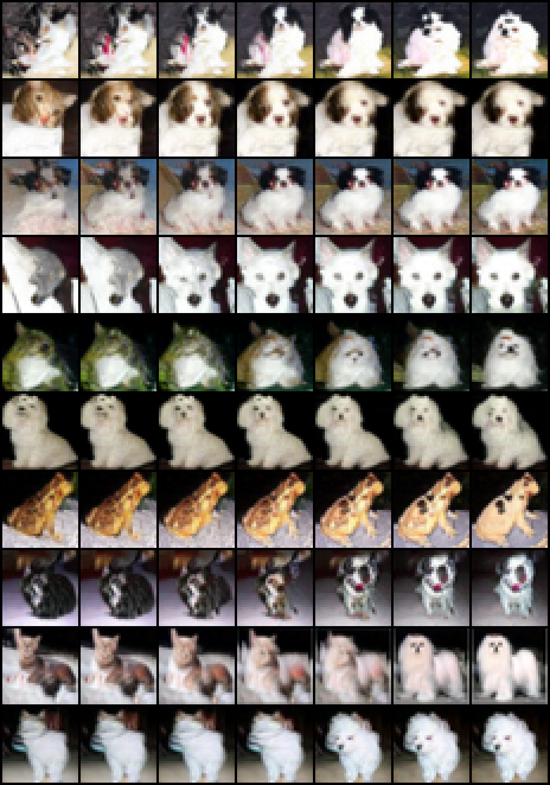

# Föllmer cat/dog coupling

A pretrained diffusion model, run as a map from a **Brownian path** to an **image** (a Föllmer
process). This is used to try the time-reversal coupling from Courtade–Fathi–Mikulincer,
[*Stochastic proof of the sharp symmetrized Talagrand inequality*](https://arxiv.org/abs/2407.09465),
on image distributions: drive the cat process with B and the dog process with the reversed
path B̂_t = B₁ − B₁₋ₜ.



## Layout

| Folder | What |
|---|---|
| [`separate_models/`](separate_models) | **Experiment 2 (matches the math).** Two separate unconditional models, one trained only on cats and one only on dogs. No classifier. |
| [`classifier_guided/`](classifier_guided) | **Experiment 1 (first proof of concept).** One all-class model, steered toward cat or dog by a classifier. Includes the blend images above and a time-slider viewer. |
| [`common/`](common) | Shared code: the path-driven Föllmer sampler, the loader that turns a score_sde model into a Föllmer drift, the Gaussian check, the CIFAR-10 download. |
| `score_sde_pytorch/` | Git submodule: [Yang Song's repo](https://github.com/yang-song/score_sde_pytorch), which provides the network architecture and the pretrained CIFAR-10 model. |

## Setup

```bash
git clone --recurse-submodules https://github.com/Shrekles/follmer-cat-dog && cd follmer-cat-dog
pip install torch torchvision ml_collections gdown scipy pandas pyarrow

python common/test_gaussian.py        # ~10 s, no downloads: the paper's Gaussian extremal case
python common/prepare_cifar.py        # CIFAR-10 -> data/

# pretrained score model (990 MB), from the score_sde_pytorch Google Drive folder
mkdir -p checkpoints/vp/cifar10_ddpmpp_continuous
gdown 1le6lIosRGjnraM-HBOsuA1zcqDV8DB76 -O checkpoints/vp/cifar10_ddpmpp_continuous/checkpoint_8.pth
```

Then follow the README in either experiment folder. All commands are run from the repository
root. Runs on CUDA, Apple MPS or CPU.

On a Mac whose Desktop or Documents folder syncs to iCloud, keep `checkpoints/` and `data/` in
folders named `checkpoints.nosync/` and `data.nosync/` with symlinks from the plain names.
iCloud otherwise offloads the large files and stalls training.
