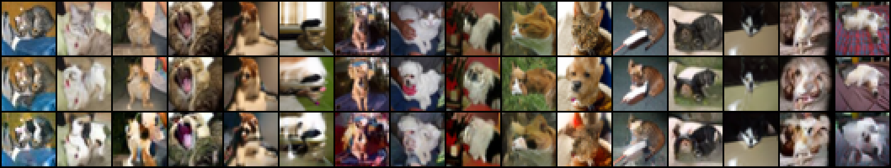

# Experiment 3: optimal transport between the two models

Experiments 1 and 2 showed that the proof's coupling (cat model on B, dog model on B̂) does not
pair cats with similar-looking dogs. Here the question is different: given the two models, can we
build the *optimal* coupling of μ (cats) and ν (dogs), meaning the Brenier map T = ∇φ that
minimizes E|X − T(X)|²?

## Methods

1. **Composed flows (no training).** Each diffusion model also defines a deterministic
   probability-flow ODE between images and Gaussian noise. Encode a cat with the cat model's ODE,
   then decode the noise with the dog model's ODE:

       T = decode_dog ∘ encode_cat            (Dual Diffusion Implicit Bridges, Su et al. 2022)

2. **Learned Brenier map.** Solve the exact optimal assignment between the 5,000 training cats and
   the 5,000 training dogs, then train a flow network on those optimal pairs, so it can map any cat
   to its optimal dog.

3. **Gaussian check.** For μ = N(0, C₁), ν = N(0, C₂), every quantity is known exactly, so the
   composed flows can be compared with the true Brenier map.

## Results

### Gaussian check (`gaussian_check.py`, exact scores, d = 16, cost per dimension)

| Case | Exact W₂² | Composed flows | Distance from exact Brenier map | Föllmer, B vs B̂ | Föllmer, same B |
|---|---|---|---|---|---|
| (a) C₂ = C₁⁻¹ (equality case) | 0.574 | 0.579 | 0.0000 | 0.574 | 0.731 |
| (b) C₂ commutes with C₁ | 0.403 | 0.408 | 0.0000 | 0.453 | 0.518 |
| (c) C₂ does not commute | 0.195 | 0.201 | 0.004 | 0.356 | 0.259 |

The composed flows equal the Brenier map whenever the covariances commute, and are very close when
they do not. The proof's reversed Föllmer coupling is optimal only in the equality case (a).

### Cats and dogs (`modal_ot.py`, then `analyze.py`; 512 real CIFAR-10 test images per direction)



*Row 1: real test cats. Row 2: composed flows. Row 3: learned Brenier map.*

| Coupling | E\|X − T(X)\|² |
|---|---|
| Composed flows, cat → dog | 102 ± 3 |
| Composed flows, dog → cat | 105 ± 3 |
| Learned Brenier map, cat → dog | 245 ± 5 |
| Learned Brenier map, dog → cat | 256 ± 5 |
| Exact optimal assignment, 5,000 train cats ↔ 5,000 train dogs | 592 |
| Exact optimal assignment, 1,000 test cats ↔ 1,000 test dogs | 660 |
| Model cat vs model dog decoded from the same noise | 88 ± 6 |

- **The composed flows give the visual we wanted.** Each real cat keeps its pose, background and
  colors, and in most images the animal becomes a dog. Some images change very little (the
  yawning cat, for example). Encoding then decoding with the same model returns the input almost
  exactly (mean squared error 0.003), so the encoding loses essentially nothing.
- **The learned Brenier map did not work well.** Its outputs are blurry cat–dog blends rather than
  dogs, and it does not reproduce the optimal pairs it was trained on (`results/train_fit_big.png`:
  error 407 against the exact-OT partner). With only 5,000 pairs in 3,072 dimensions, the network
  averages over many possible partners. Its cost of 245 is low only because its outputs are not
  realistic dogs, so it cannot serve as a reference for the true optimal cost.
- **The real-photo assignment costs (592, 660) are not directly comparable.** They must match each
  cat to an existing dog photo from a finite set, which costs far more than mapping to the nearest
  plausible dog.

## Caveats

- The composed flows are not exactly the Brenier map for non-Gaussian data (flow maps of diffusions
  are not optimal in general; Lavenant–Santambrogio 2022). What we can say is that they are exact
  for commuting Gaussians, and that they give a much cheaper coupling than the proof's.
- The cat and dog models were fine-tuned from the same pretrained model, so their distributions
  overlap more than real cats and dogs do. This makes the composed flows' job easier and partly
  explains the low cost.

## Run

```bash
python optimal_transport/gaussian_check.py       # ~20 s, CPU, no networks
modal run optimal_transport/modal_ot.py           # composed flows (~30 min) and learned map (~75 min), in parallel
python optimal_transport/analyze.py               # figures and summary.json from the downloaded results
```

`modal_ot.py --smoke` runs both jobs at tiny sizes to check the pipeline for a few cents.
