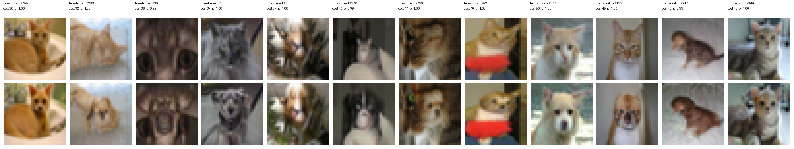
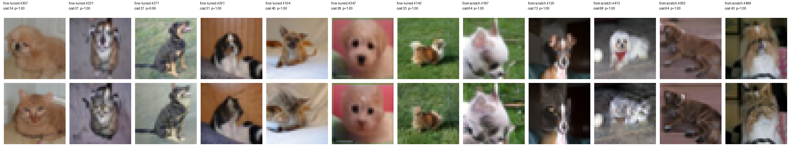

# Gallery: the clearest cat ↔ dog translations

These are hand-picked pairs from the composed probability-flow ODE (cat → noise → dog, and the
reverse). Each shows what the experiment aims for: the same photo, pose, background and colors,
with the animal swapped, at a small transport cost E|X − T(X)|².

**How they were chosen.** Every output for the first 512 CIFAR-10 test images of each class was
scored, using the outputs of the fine-tuned pair and of the re-picked from-scratch pair. A pair
made the shortlist when:
- the judge classifier is confident the input is the source animal (p ≥ 0.7);
- it is confident the output is the target animal (p ≥ 0.95);
- the output keeps almost nothing of the source animal (p ≤ 0.02);
- the cost is at least 30, which rules out near-unchanged images the judge mislabels from fur
  texture.

The 20 lowest-cost candidates per model and direction were then inspected by eye at 5× zoom. The
24 shown here are the clearest same-scene translations among them.

**Read these as illustrations, not averages.** These pairs cost 30–73. The mean over all 1,000
test images is 99 (cat → dog) and 109 (dog → cat) for the fine-tuned pair, and about a quarter of
all outputs are not convincing. `gallery.json` lists each pair's model, test index, cost and judge
probabilities.

- **Fine-tuned pair:** the 16,000-step single-class models fine-tuned from the pretrained
  CIFAR-10 model (`out/cat.pth`, `out/dog.pth` on the Modal volume).
- **From scratch:** independently trained 9.9M-parameter models, re-picked in iteration 06.
  - cat → dog: encoder `iter04/cat_s12129`, decoder `iter04/dog_s20119`
  - dog → cat: encoder `iter04/dog_s17541`, decoder `iter04/cat_s22457`
