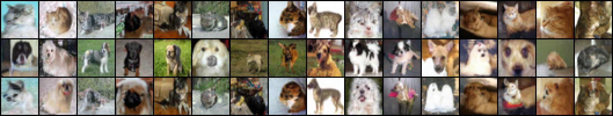

# Experiment 2: two separate models, no classifier

This is the setup that matches the math. There is one unconditional model per distribution:

- **μ** = the law of samples from a model trained **only on cats**
- **ν** = the law of samples from a model trained **only on dogs**

No labels and no classifier are used when sampling.

## The math being implemented

From Courtade–Fathi–Mikulincer, [arXiv:2407.09465](https://arxiv.org/abs/2407.09465).
Work on Wiener space over [0, 1]. B is the Brownian motion, and

    B̂_t = B_1 − B_{1−t}

is its time reversal. B̂ is also a Brownian motion, but adapted to the reversed filtration.

1. **Each distribution has a Föllmer process.** For a target law μ,

       dX_t = v_μ(X_t, t) dt + dB_t,   X_0 = 0,   v_μ(x, t) = (E[X_1 | X_t = x] − x) / (1 − t)

   ends at X_1 ~ μ, and its drift has the least energy: D(μ‖γ) = ½ E∫|v_μ|² dt.
2. **The coupling.** Drive μ's process with B and ν's process with B̂:

       X = Föllmer_μ(B) ~ μ,      Y = Föllmer_ν(B̂) ~ ν

   Both are functions of the same Brownian path ω, so (X, Y) is a coupling of μ and ν.
3. **The inequality.** For centered μ,

       W₂²(μ, ν)  ≤  E|X − Y|²  ≤  2D(μ‖γ) + 2D(ν‖γ)

   In the Gaussian extremal case μ = N(0, C), ν = N(0, C⁻¹), this coupling is the optimal one
   (checked numerically in `common/test_gaussian.py`).

## How the code maps to it

| Math | Code |
|---|---|
| μ, ν | `checkpoints/cat.pth`, `checkpoints/dog.pth`, made by `finetune.py` |
| v_μ, v_ν | each network's denoiser E[X₁ \| X_t], converted to the Föllmer drift in `common/score_sde_backend.py` |
| B, B̂ | `BrownianPath` and `.reversed()` in `common/follmer.py`. The time grid is symmetric, so B̂ is exactly B's increments in reverse order |
| X, Y | `run_pairs.py`: cat model on B, dog model on B̂ |
| E\|X − Y\|² | averaged over paths in `run_pairs.py`, next to three comparison couplings (dog model on the same B, on −B, on an independent path) |
| D(μ‖γ), D(ν‖γ) | ½∫\|v\|² dt accumulated along each path |

## Run

From the repository root:

```bash
modal run separate_models/modal_train.py                        # both models on Modal GPUs, ~20 min
# or locally (slow: ~5 h per model on an M2):
#   python separate_models/finetune.py --cls cat --steps 3200
#   python separate_models/finetune.py --cls dog --steps 3200
python separate_models/run_pairs.py --n 16 --steps 400         # ~20 min
```

`finetune.py` saves its state every 200 steps; add `--resume` to continue after an interruption.
`run_pairs.py` writes `results/pairs/pairs_big.png` (rows: cat on B, dog on B̂, dog on B),
`summary.json`, and `viewer.html`, a page with a time slider.

## Caveats

- **The two models share a starting point.** Each is fine-tuned from the same pretrained
  all-class CIFAR-10 model, one on the 5,000 cats and one on the 5,000 dogs. They are separate
  unconditional models, but not trained from scratch (that would take days on a laptop).
- **The theorem bounds a cost; it does not promise the pair looks alike.** In Experiment 1
  (`../classifier_guided`), pairs driven by B and B̂ looked unrelated, while pairs driven by the
  same B shared layout and colors. This experiment tests whether that holds with separate models.
- **D(·‖γ) is effectively infinite for images**, which lie close to a low-dimensional set. The
  right-hand side of the inequality is therefore huge, and the comparison between couplings is
  the informative part.
- **μ is not exactly centered** (CIFAR pixel means are slightly below zero), which the theorem
  assumes.

## Results

Models: fine-tuned for 16,000 steps at batch 64 on Modal (A10G, about 80 minutes each in total) with
`modal run separate_models/modal_train.py --steps 16000 --lr 1e-4`. An earlier 4,000-step version
still produced a few other-class images; its results are kept in `results/pairs_v1_4k/`. Pairing: 16 Brownian paths, 400 Euler steps.



*Row 1: cat model driven by B. Row 2: dog model driven by the reversed path B̂ (the coupling
from the math). Row 3: dog model driven by the same forward path B.*

| Dog model driven by | E\|X − Y\|² (dim 3072) |
|---|---|
| B̂ (reversed; the math's coupling) | 1107 ± 174 |
| B (same forward path) | 129 ± 28 |
| independent path | 1641 ± 138 |
| −B | 3142 ± 281 |

- Finite-sample OT cost between the 16 cat and 16 dog samples: 933.
- Energy estimates: D(μ‖γ) ≈ 10,700 and D(ν‖γ) ≈ 10,700, so 2D(μ‖γ) + 2D(ν‖γ) ≈ 43,000.
- Paired over the same 16 paths, the reversed coupling costs 534 ± 213 less than an independent
  path (lower on 13 of 16 paths), and 977 ± 165 more than the same forward path (higher on 16 of 16).

What this shows:

- **The inequality holds with a very large margin**: 1107 against 43,000.
- **The forward/reverse pairs do not look alike.** The reversed coupling is cheaper than an
  independent path, but the images in rows 1 and 2 share little visually.
- **The same forward path gives near-twins** (row 3 against row 1). This is partly because both
  models were fine-tuned from the same starting model, so their drifts are close.
- **Purity.** In 64 samples per model (`results/preview_big.png`), the clear images are all cats
  (cat model) and all dogs (dog model). A classifier used only as a judge (`purity.py`) scores them
  61% cat and 67% dog, the same as it scores real CIFAR photos (56% and 65%), so it cannot tell them
  from real ones. A few samples remain ambiguous at 32×32, for example deer-like dogs on grass.

`results/pairs/viewer.html` has a time slider for all 16 paths, and `results/pairs/all_paths_*_big.png`
show every path over time. `results/preview_big.png` shows 64 samples from each model on the same paths.
